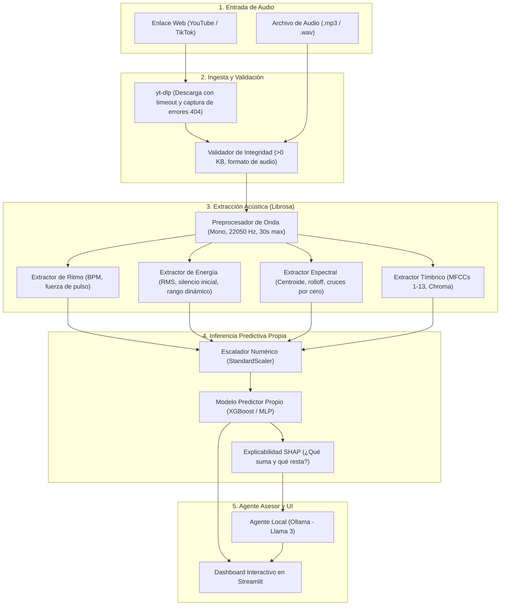

# Predictor de Engagement Acústico con IA

Sistema de predicción de alcance e interacción (*engagement*) para publicaciones en redes sociales a partir de señales de **audio y música**. El proyecto combina extracción matemática de señales acústicas mediante Procesamiento Digital de Señales (`librosa`), modelos propios de Machine Learning (`XGBoost`, `Random Forest`, `MLP`) y un agente de lenguaje local (`Ollama`) que traduce las métricas predichas en recomendaciones concretas de edición de sonido antes de publicar.

---

## 1. Propósito y Enfoque Técnico

Entrenar una red neuronal profunda de extremo a extremo con audio crudo requiere miles de horas de cómputo y millones de muestras. Este proyecto resuelve el problema mediante **fusión tabular de características acústicas** (*Feature-Level Tabular Fusion*): el audio pasa por extractores matemáticos especializados que resumen la señal en variables numéricas interpretables (tempo, silencios iniciales, brillo espectral, energía RMS y coeficientes MFCC).

Con esta matriz unificada, el modelo estima la tasa de interacción esperada:

$$\text{Engagement Rate} = \frac{\text{Likes} + \text{Comments} + \text{Shares}}{\text{Views}}$$

Una vez calculada la predicción y el impacto de cada variable mediante explicabilidad (`SHAP`), un modelo local ejecutado en `Ollama` (`Llama 3` o `Mistral`) recibe las métricas que penalizaron la puntuación y redacta sugerencias prácticas de edición sonora.

---

## 2. Arquitectura General del Sistema



---

## 3. Principio de Parametrización Absoluta (Zero-Hardcoding)

Para garantizar máxima flexibilidad y facilidad de modificación durante el desarrollo y la sustentación ante evaluadores, **ningún archivo de código fuente contiene números mágicos ni rutas fijas escritas a mano**.

* Toda constante física, matemática, temporal y de modelado reside exclusivamente en:
  * [`config/settings.py`](file:///c:/Users/MEGAPC/Desktop/Predictor_Engagement-IA/Proyecto-IA-Predictor-Viralidad/config/settings.py) (Parámetros globales del sistema).
  * [`.env`](file:///c:/Users/MEGAPC/Desktop/Predictor_Engagement-IA/Proyecto-IA-Predictor-Viralidad/.env) (Variables locales del entorno).
* **Beneficio directo:** Si un evaluador solicita cambiar la duración analizada de 30 a 15 segundos o modificar la frecuencia de muestreo de $22,050 \text{ Hz}$ a $44,100 \text{ Hz}$, se cambia **una única línea** en `settings.py` y todo el pipeline (extractores, escaladores y modelos) se adapta de inmediato.

---

## 4. Componentes del Entorno y Archivos de Instalación

El entorno de desarrollo cuenta con los archivos base de instalación, y cada integrante implementará los módulos de configuración y scripts utilitarios:

| Archivo | Estado / Tipo | ¿Qué hace y para qué sirve? |
| :--- | :--- | :--- |
| [`pyproject.toml`](file:///c:/Users/MEGAPC/Desktop/Predictor_Engagement-IA/Proyecto-IA-Predictor-Viralidad/pyproject.toml) | **Base Instalada** (PEP 517/621) | Permite instalar el proyecto como paquete local editable (`pip install -e .`). Evita errores de `ModuleNotFoundError` al importar módulos de `src` desde cualquier carpeta o notebook. |
| [`requirements.txt`](file:///c:/Users/MEGAPC/Desktop/Predictor_Engagement-IA/Proyecto-IA-Predictor-Viralidad/requirements.txt) | **Base Instalada** (Dependencias) | Lista todas las bibliotecas de Python con sus versiones congeladas (DSP, ML, UI, LLM y Testing) para asegurar reproducibilidad exacta en cualquier computadora. |
| [`.env.example`](file:///c:/Users/MEGAPC/Desktop/Predictor_Engagement-IA/Proyecto-IA-Predictor-Viralidad/.env.example) | **Base Instalada** (Plantilla) | Documenta las variables de entorno configurables (puerto y modelo de Ollama, timeouts de red y duración de audio) sin exponer secretos ni datos locales en el control de versiones. |
| `config/settings.py` | *Entregable Rol 1* (Configuración) | Centraliza rutas dinámicas (`pathlib.Path`), parámetros de la Transformada de Fourier (`N_FFT`, `HOP_LENGTH`), tasa de muestreo y semillas aleatorias. |
| `config/logging_config.py` | *Entregable Rol 1* (Registro) | Reemplaza llamadas informales a `print()` por un registro formal de eventos en consola y en el archivo rotativo `logs/sistema.log`. |
| `scripts/init_dirs.py` | *Entregable Rol 2* (Directorios) | Script utilitario que asegura la existencia de los directorios de datos crudos, medios y modelos guardados en instalaciones nuevas. |
| `scripts/check_environment.py` | *Entregable Rol 3* (Diagnóstico) | Verifica en segundos que Python sea $\ge 3.10$, que el binario de `FFmpeg` esté activo en el sistema y que el servidor de `Ollama` esté respondiendo. |

---

## 5. Tutorial de Instalación Paso a Paso

Sigue estos pasos en tu terminal (PowerShell en Windows o Bash en Linux/macOS) para dejar el entorno 100% operativo:

### Paso 1: Clonar el repositorio y entrar a la carpeta
```bash
git clone https://github.com/FelipeM197/Proyecto-IA-Predictor-Viralidad.git
cd Proyecto-IA-Predictor-Viralidad
```

### Paso 2: Crear y activar el entorno virtual de Python
```bash
# Crear el entorno virtual (si no está creado)
python -m venv .venv

# Activar en Windows (PowerShell)
.venv\Scripts\activate

# Activar en Linux / macOS
source .venv/bin/activate
```

### Paso 3: Instalar las dependencias del proyecto
```bash
# Instalar todas las librerías científicas, de audio, ML y UI
pip install -r requirements.txt

# Instalar el proyecto en modo editable (usando pyproject.toml)
pip install -e .
```

### Paso 4: Configurar variables de entorno locales
```bash
# En Windows (PowerShell)
Copy-Item .env.example .env

# En Linux / macOS
cp .env.example .env
```

### Paso 5: Auditar el entorno y dependencias del sistema
Una vez implementado `scripts/check_environment.py` por el Rol 3, ejecuta el script de diagnóstico para verificar que `FFmpeg` y `Python` estén listos:
```bash
python scripts/check_environment.py
```

> [!NOTE]
> **Requisito del Sistema (FFmpeg):** `yt-dlp` y `librosa` requieren el ejecutable de `FFmpeg` en el sistema. Si el script de diagnóstico indica que falta, instálalo en Windows ejecutando:
> ```powershell
> winget install Gyan.FFmpeg
> ```
> Y reinicia tu terminal.

> [!TIP]
> **Para el Agente de Lenguaje (Ollama):** Si deseas ejecutar las recomendaciones con LLM local, instala Ollama desde [ollama.com](https://ollama.com) y descarga el modelo Llama 3 ejecutando:
> ```bash
> ollama pull llama3
> ```
