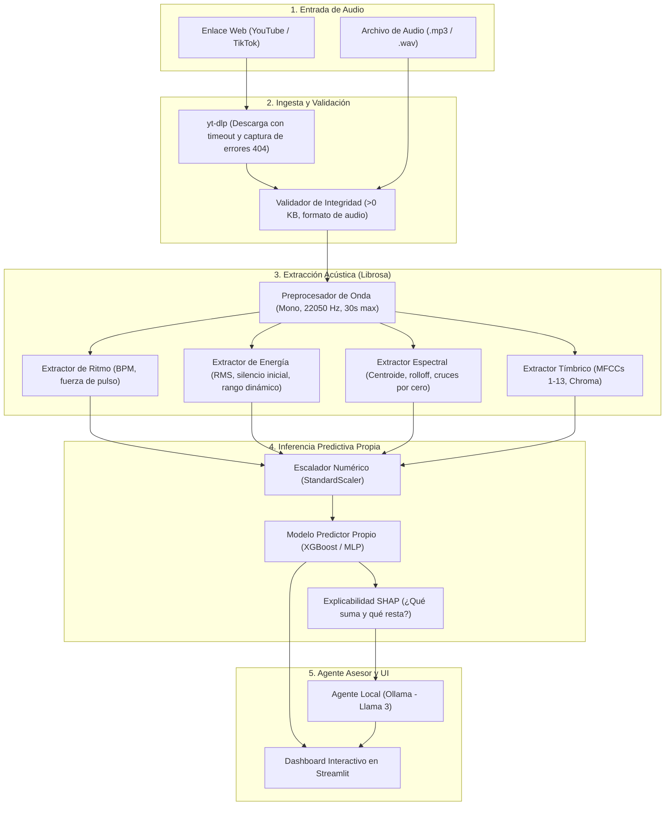

# Predictor de Engagement Acústico con IA

Sistema de predicción de alcance e interacción (*engagement*) para publicaciones en redes sociales a partir de señales de **audio y música**. El proyecto combina extracción matemática de señales acústicas mediante Procesamiento Digital de Señales (`librosa`), modelos propios de Machine Learning (`XGBoost`, `Random Forest`, `MLP`) y un agente de lenguaje local (`Ollama`) que traduce las métricas predichas en recomendaciones concretas de edición de sonido antes de publicar.

---

## 1. Propósito y Enfoque Técnico

Entrenar una red neuronal profunda de extremo a extremo con audio crudo requiere miles de horas de cómputo y millones de muestras. Este proyecto resuelve el problema mediante **fusión tabular de características acústicas** (*Feature-Level Tabular Fusion*): el audio pasa por extractores matemáticos especializados que resumen la señal en variables numéricas interpretables (tempo, silencios iniciales, brillo espectral, energía RMS y coeficientes MFCC).

Con esta matriz unificada, el modelo estima la tasa de interacción esperada:

$$\text{Engagement Rate} = \frac{\text{Likes} + \text{Comments} + \text{Shares}}{\text{Views}}$$

Una vez calculada la predicción y el impacto de cada variable mediante explicabilidad (`SHAP`), un modelo local ejecutado en `Ollama` (`Llama 3` o `Mistral`) recibe las métricas que penalizaron la puntuación y redacta sugerencias prácticas de edición sonora.

---

## 2. Arquitectura General del Sistema



---

## 3. Principio de Parametrización Absoluta (Zero-Hardcoding)

Para garantizar máxima flexibilidad y facilidad de modificación durante el desarrollo y la sustentación ante evaluadores, **ningún archivo de código fuente contiene números mágicos ni rutas fijas escritas a mano**.

* Toda constante física, matemática, temporal y de modelado reside exclusivamente en:
  * [`config/settings.py`](config/settings.py) (Parámetros globales del sistema).
  * `.env` (Variables locales del entorno, excluido del control de versiones en `.gitignore`).
* **Beneficio directo:** Si un evaluador solicita cambiar la duración analizada de 30 a 15 segundos o modificar la frecuencia de muestreo de $22,050 \text{ Hz}$ a $44,100 \text{ Hz}$, se cambia **una única línea** en `settings.py` y todo el pipeline (extractores, escaladores y modelos) se adapta de inmediato.

---

## 4. Componentes del Entorno e Infraestructura Implementada

La infraestructura base, los scripts de diagnóstico, el empaquetado editable y los módulos del pipeline ya están implementados y operativos dentro del repositorio:

| Archivo | Estado / Tipo | Propósito en el proyecto |
| :--- | :--- | :--- |
| [`pyproject.toml`](pyproject.toml) | **Base Declarativa** (PEP 517/621) | Configuración de empaquetado editable (`pip install -e .`). Expone `config`, `src` y `app` como paquetes importables. |
| [`requirements.txt`](requirements.txt) | **Base Declarativa** (Dependencias) | Lista las bibliotecas de Python con versiones fijadas (DSP, ML, SHAP, UI, LLM y pruebas) para reproducibilidad entre equipos. |
| [`.env.example`](.env.example) | **Base Declarativa** (Plantilla) | Documenta variables configurables (servidor y modelo de Ollama, timeouts de red y duración máxima de audio) sin exponer secretos. |
| [`config/settings.py`](config/settings.py) | **Implementado** (Configuración) | Centraliza rutas dinámicas (`pathlib.Path`), parámetros STFT (`N_FFT`, `HOP_LENGTH`), hiperparámetros de modelos y semillas aleatorias. |
| [`config/logging_config.py`](config/logging_config.py) | **Implementado** (Registro) | Centraliza bitácoras estructuradas en consola estándar y archivo rotativo `logs/sistema.log` (límite de 5 MB). |
| [`scripts/init_dirs.py`](scripts/init_dirs.py) | **Implementado** (Directorios) | Verifica y crea las carpetas de datos crudos, medios, matrices procesadas, modelos y logs con marcadores `.gitkeep`. |
| [`scripts/check_environment.py`](scripts/check_environment.py) | **Implementado** (Diagnóstico) | Comprueba que Python sea $\ge 3.10$, que `FFmpeg` esté en `PATH` y si el servidor local de `Ollama` responde. |

---

## 5. Tutorial de Instalación Paso a Paso

Sigue estos pasos en tu terminal (PowerShell en Windows o Bash en Linux/macOS) para dejar el entorno 100% operativo:

### Paso 1: Clonar el repositorio y entrar a la carpeta
```bash
git clone https://github.com/FelipeM197/Proyecto-IA-Predictor-Viralidad.git
cd Proyecto-IA-Predictor-Viralidad
```

### Paso 2: Crear y activar el entorno virtual de Python
```bash
# Crear el entorno virtual (si no está creado)
python -m venv .venv

# Activar en Windows (PowerShell)
.venv\Scripts\activate

# Activar en Linux / macOS
source .venv/bin/activate
```

### Paso 3: Instalar las dependencias del proyecto
```bash
# Instalar todas las librerías científicas, de audio, ML y UI
pip install -r requirements.txt

# Instalar el proyecto en modo editable (usando pyproject.toml)
pip install -e .
```

### Paso 4: Configurar variables de entorno locales
```bash
# En Windows (PowerShell)
Copy-Item .env.example .env

# En Linux / macOS
cp .env.example .env
```

### Paso 5: Auditar el entorno y dependencias del sistema
Ejecuta [`scripts/check_environment.py`](scripts/check_environment.py) para verificar que `Python`, `FFmpeg` y `Ollama` estén operativos:
```bash
python scripts/check_environment.py
```

> [!NOTE]
> **Requisito del Sistema (FFmpeg):** `yt-dlp` y `librosa` requieren el ejecutable de `FFmpeg` en el sistema. Si el script de diagnóstico indica que falta, instálalo en Windows ejecutando:
> ```powershell
> winget install Gyan.FFmpeg
> ```
> Y reinicia tu terminal.

> [!TIP]
> **Para el Agente de Lenguaje (Ollama):** Si deseas ejecutar las recomendaciones con LLM local, instala Ollama desde [ollama.com](https://ollama.com) y descarga el modelo configurado ejecutando:
> ```bash
> ollama pull llama3
> ```

---

## 6. Módulos de Modelado y Explicabilidad (`src/modelos/`)

El paquete `src/modelos/` implementa el entrenamiento comparativo de tres familias de algoritmos y la descomposición aditiva de predicciones sobre las 28 características acústicas estandarizadas.

| Módulo | Fase | Responsabilidad Técnica |
| :--- | :---: | :--- |
| [`src/modelos/__init__.py`](src/modelos/__init__.py) | 5 y 6 | Exporta 18 símbolos públicos bajo carga diferida (PEP 562), evitando advertencias de `runpy` al ejecutar submódulos con `python -m`. |
| [`src/modelos/modelo_baseline.py`](src/modelos/modelo_baseline.py) | 5 | Ajusta `RidgeCV` (regularización $L_2$) y `ElasticNetCV` (mezcla $L_1 + L_2$, `max_iter=5000`) como líneas base lineales. |
| [`src/modelos/modelo_red_neuronal.py`](src/modelos/modelo_red_neuronal.py) | 5 | Define `RedNeuronalAcustica` sobre `MLPRegressor` `(128, 64, 32)`, activación `ReLU`, optimizador `adam` y parada temprana (`early_stopping=True`). |
| [`src/modelos/modelo_arboles.py`](src/modelos/modelo_arboles.py) | 5 | Configura `RandomForestRegressor` (200 árboles bootstrap, `max_depth=10`) y `XGBRegressor` con `tree_method="hist"`. |
| [`src/modelos/optimizador_hiperparametros.py`](src/modelos/optimizador_hiperparametros.py) | 5 | Ejecuta `GridSearchCV` con `KFold(n_splits=5, shuffle=True)` sobre 18 combinaciones de `XGBRegressor` minimizando el RMSE. |
| [`src/modelos/evaluador_metricas.py`](src/modelos/evaluador_metricas.py) | 5 | Orquesta ingesta, partición estratificada $70 / 15 / 15$ sin fuga de datos, entrenamiento completo, evaluación en prueba (`MAE`, `RMSE`, `R2`) y guardado de artefactos. |
| [`src/modelos/explicabilidad_shap.py`](src/modelos/explicabilidad_shap.py) | 6 | Calcula valores exactos de Shapley con `shap.TreeExplainer`, extrae los top 3 atributos favorables o perjudiciales y deriva cuantiles virales en escala física. |

---

## 7. Artefactos en `modelos_guardados/` y Benchmark Actual

La ejecución del pipeline serializa modelos binarios y reportes JSON en `modelos_guardados/`. Los pesos `.joblib` están excluidos de Git en [`.gitignore`](.gitignore) y se regeneran localmente con los comandos de la Sección 9:

* `modelos_guardados/escalador_acustico.joblib`: `StandardScaler` ajustado exclusivamente sobre la partición de entrenamiento (`n_train = 560`).
* `modelos_guardados/modelo_mlp_final.joblib`: estimador `MLPRegressor` nativo listo para `.predict()`.
* `modelos_guardados/modelo_xgboost_final.joblib`: `XGBRegressor` calibrado consumido por el motor de inferencia y `TreeExplainer`.
* [`modelos_guardados/reporte_comparativo_modelos.json`](modelos_guardados/reporte_comparativo_modelos.json): métricas comparativas en el conjunto ciego de prueba y resumen de validación cruzada.
* [`modelos_guardados/umbrales_virales.json`](modelos_guardados/umbrales_virales.json): percentiles `p25`, `p50`, `p75` y `media` en unidades físicas para las 28 variables sobre el 15 % superior de `engagement_rate` en entrenamiento.

### Resumen de Métricas Observadas (`respaldo_tiktok_csv`, partición 560 / 120 / 120)

| Modelo | MAE (test) | RMSE (test) | $R^2$ (test) | Rol en el sistema |
| :--- | :---: | :---: | :---: | :--- |
| `elasticnet` | `0.008573` | `0.010699` | `0.2535` | Menor error empírico en test (`mejor_modelo_test`) |
| `random_forest` | `0.008848` | `0.010889` | `0.2268` | Ensamble por *bagging* |
| `ridge` | `0.008691` | `0.010944` | `0.2189` | Línea base $L_2$ |
| `xgboost` | `0.008935` | `0.011012` | `0.2093` | Seleccionado para producción y `TreeExplainer` |
| `mlp` | `0.012307` | `0.015471` | `-0.5608` | Red neuronal tabular de comparación |

La optimización por validación cruzada de 5 pliegues sobre 18 combinaciones seleccionó `learning_rate = 0.03`, `max_depth = 3` y `n_estimators = 100` con `mejor_rmse_cv = 0.011642`. `ElasticNetCV` obtuvo el mejor ajuste puntual sobre este subconjunto tabular de respaldo, mientras `XGBRegressor` permanece como `modelo_seleccionado_produccion` para sostener el contrato de explicabilidad exacta con `TreeExplainer` en tiempo real.

---

## 8. Cuadernos de Sustento Académico (`notebooks/`)

Cada etapa técnica cuenta con un cuaderno reproducible en `notebooks/`:

* [`notebooks/01_auditoria_ingesta_y_caidos.ipynb`](notebooks/01_auditoria_ingesta_y_caidos.ipynb): Auditoría de ingesta, supervivencia de enlaces y respaldo tabular.
* [`notebooks/02_laboratorio_senales_dsp.ipynb`](notebooks/02_laboratorio_senales_dsp.ipynb): Laboratorio de procesamiento digital de señales acústicas (DSP).
* [`notebooks/03_analisis_estadistico_target.ipynb`](notebooks/03_analisis_estadistico_target.ipynb): Análisis estadístico de la variable objetivo y selección de características.
* [`notebooks/04_benchmark_modelos_y_shap.ipynb`](notebooks/04_benchmark_modelos_y_shap.ipynb): Benchmark comparativo de modelos y explicabilidad SHAP.

---

## 9. Comandos Reproducibles en PowerShell (`.venv`)

Ejecuta estos comandos desde la raíz del repositorio en Windows PowerShell para entrenar, recalcular umbrales virales y verificar la suite de pruebas:

* **Entrenamiento y evaluación comparativa (Fase 5):**
```powershell
.\.venv\Scripts\python.exe -m src.modelos.evaluador_metricas
```

* **Generación de umbrales virales SHAP en escala física (Fase 6):**
```powershell
.\.venv\Scripts\python.exe -m src.modelos.explicabilidad_shap
```

* **Ejecución silenciosa de pruebas unitarias y de integración (Fase 10):**
```powershell
.\.venv\Scripts\python.exe -m pytest tests/test_modelos_inferencia.py tests/test_preprocesamiento.py -q --tb=short
```
