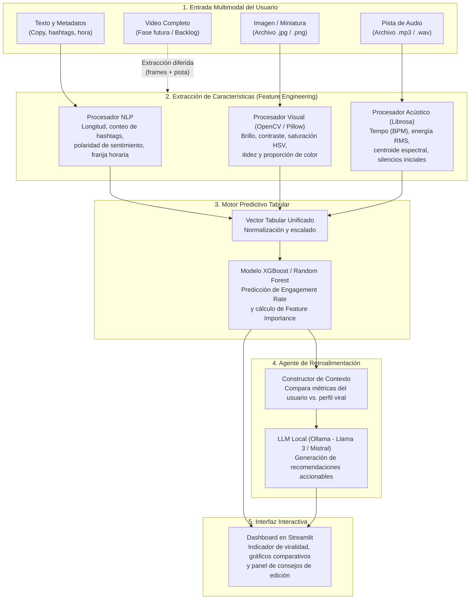
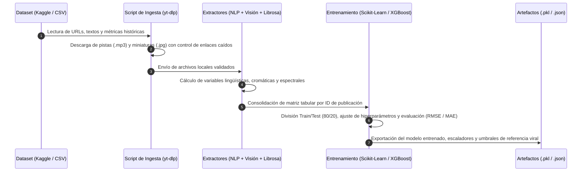

# Predictor de Viralidad Multimodal

Sistema de predicción de alcance e interacción (*engagement*) para publicaciones en redes sociales a partir de señales multimodales: **texto**, **imagen** y **música/audio**. El proyecto combina extracción matemática de características sobre medios crudos, modelos de árboles potenciados por gradiente (`XGBoost`) y un agente de lenguaje local (`Ollama`) que traduce las métricas predichas en recomendaciones editables antes de publicar.

---

## 1. Propósito y Enfoque Técnico

Entrenar una red neuronal profunda de extremo a extremo con audio, imagen y texto requiere miles de horas de cómputo y millones de muestras. Este proyecto resuelve el problema mediante **fusión tabular de características** (*Feature-Level Tabular Fusion*): cada modalidad pasa por un extractor especializado que resume la señal en variables numéricas interpretables.

Con esta matriz unificada, un modelo `XGBoost` estima la tasa de interacción esperada:

$$\text{Engagement Rate} = \frac{\text{Likes} + \text{Comments} + \text{Shares}}{\text{Views}}$$

Una vez calculada la predicción y la importancia de cada variable, un modelo local ejecutado en `Ollama` (`Llama 3` o `Mistral`) recibe los valores fuera de rango respecto al percentil viral y redacta sugerencias concretas sobre el ritmo de la pista, la composición visual o la estructura del texto.

---

## 2. Arquitectura Beta del Sistema

### 2.1 Flujo General de Procesamiento e Inferencia



### 2.2 Pipeline de Datos y Entrenamiento (Offline)



---

## 3. Componentes por Modalidad

| Modalidad | Estado | Variables Extraídas | Herramientas Base |
| :--- | :--- | :--- | :--- |
| **Texto y Metadatos** | Fase Inicial | Conteo de palabras, densidad de hashtags, polaridad de sentimiento `[-1, 1]`, día de la semana y franja horaria. | `pandas`, `VADER` / `TextBlob` / `pysentimiento` |
| **Música y Audio** | Fase Inicial | Tempo en pulsos por minuto (`BPM`), energía media (`RMS`), centroide espectral (brillo acústico) y segundos de silencio al inicio. | `librosa`, `yt-dlp`, `numpy` |
| **Imagen / Portada** | Fase Inicial | Brillo medio, contraste, saturación en espacio `HSV`, nitidez por varianza del Laplaciano y dominancia cálida/fría. | `opencv-python`, `Pillow` |
| **Video** | Fase Futura | Ritmo de cortes de escena, movimiento óptico en los primeros 3 segundos y subtítulos incrustados (OCR). | `opencv-python`, `scenedetect` |

---

## 4. Funcionamiento Paso a Paso en Producción

1. **Carga de contenido:** El usuario ingresa desde la interfaz de `Streamlit` el texto de su publicación, la hora prevista de lanzamiento, la imagen o miniatura y el archivo de audio (`.mp3` o `.wav`).
2. **Vectorización en tiempo real:** El backend procesa el texto, analiza el histograma de la imagen y descompone la onda de sonido con `librosa`. Todo el bloque se convierte en una fila numérica en menos de tres segundos.
3. **Inferencia e interpretabilidad:** El modelo `XGBoost` devuelve el porcentaje estimado de `Engagement Rate` y ordena las variables según su peso en la decisión.
4. **Diagnóstico con IA generativa:** Un módulo intermedio toma las variables que penalizaron la puntuación (por ejemplo, un silencio inicial mayor a dos segundos o un ritmo inferior a 95 BPM) y las inyecta en un prompt estructurado hacia `Ollama`.
5. **Visualización:** La pantalla muestra el indicador de rendimiento estimado, un gráfico radial comparando la publicación contra el promedio de contenido viral y las correcciones sugeridas por el modelo de lenguaje.

---

## 5. Organización del Equipo y Fases de Desarrollo

El desarrollo se distribuye en tres áreas técnicas a lo largo de 12 semanas:

* **Ingeniería de Datos y NLP (Miembro A):** Curación de datasets de Kaggle, limpieza de registros rotos, cálculo de la variable objetivo y extracción de variables textuales, visuales y temporales.
* **Procesamiento de Señales y Audio (Miembro B):** Automatización de descargas con `yt-dlp`, manejo de errores de red y extracción acústica mediante `librosa`.
* **Modelado Predictivo, LLM e Interfaz (Miembro C):** Entrenamiento y validación de `XGBoost` frente a líneas base lineales, integración local con `Ollama` y construcción de la aplicación en `Streamlit`.

### Cronograma Resumido

| Semanas | Fase | Entregable Principal |
| :--- | :--- | :--- |
| **1 - 2** | Configuración y Adquisición | Repositorio activo, entorno virtual configurado y dataset filtrado con descargas de audio/miniatura operativas. |
| **3 - 4** | Ingeniería de Texto e Imagen | Script de extracción de sentimiento, metadatos horarios y métricas cromáticas de imagen. |
| **3 - 5** | Ingeniería de Audio | Pipeline en `librosa` con extracción de BPM, energía RMS, centroide espectral y tabla unificada final. |
| **6 - 7** | Modelado Predictivo | Modelo `XGBoost` validado (MAE/RMSE), comparativa contra regresión base y análisis de importancia de variables. |
| **8 - 9** | Agente de Feedback | Integración con `Ollama` y plantillas de prompt conectadas a las salidas numéricas del regresor. |
| **10 - 12** | Producto Mínimo Viable | Aplicación interactiva en `Streamlit` integrada de extremo a extremo. |

---

## 6. Estructura Prevista del Repositorio

```text
Proyecto-IA-Predictor-Viralidad/
├── datos/
│   ├── crudos/                  # CSVs originales de Kaggle
│   ├── medios/                  # Audios (.mp3/.wav) e imágenes descargadas
│   └── procesados/              # Matriz tabular unificada lista para entrenamiento
├── src/
│   ├── ingesta/                 # Scripts de descarga con yt-dlp y validación de enlaces
│   ├── caracteristicas/         # Extractores de texto, imagen (OpenCV) y audio (Librosa)
│   ├── modelos/                 # Entrenamiento, evaluación y serialización de XGBoost
│   └── agente/                  # Conexión con Ollama y plantillas de prompts
├── app/
│   └── interfaz.py              # Aplicación web en Streamlit
├── notebooks/                   # Exploración de datos y pruebas de modelos
├── requirements.txt             # Dependencias del proyecto
└── README.md
```

---

## 7. Requisitos e Instalación Base

### Dependencias Principales
* Python 3.10+
* Procesamiento y ML: `pandas`, `numpy`, `scikit-learn`, `xgboost`
* Audio, Imagen y Texto: `librosa`, `yt-dlp`, `opencv-python`, `Pillow`, `vaderSentiment` / `textblob`
* Agente e Interfaz: `ollama`, `streamlit`, `plotly`

### Ejecución Local (Entorno de Desarrollo)

```bash
git clone https://github.com/FelipeM197/Proyecto-IA-Predictor-Viralidad.git
cd Proyecto-IA-Predictor-Viralidad
python -m venv .venv
.venv\Scripts\activate
pip install pandas numpy scikit-learn xgboost librosa yt-dlp opencv-python Pillow streamlit ollama
```
