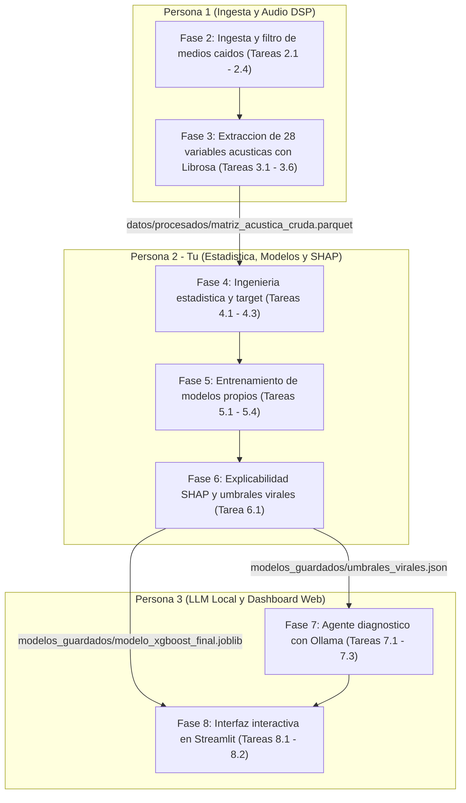

# Estado Actual del Proyecto y Hoja de Ruta para los Tres Integrantes

> **Documento complementario de control y auditoría operativa**  
> Este informe se lee en conjunto con el documento base: **`plan_maestro_detallado.md`** (*Plan maestro de ingeniería y defensa técnica: Sistema predictivo de interacción en redes sociales mediante señales acústicas e inteligencia artificial*). Su propósito es registrar el avance físico consolidado en el repositorio y mapear los entregables de cada integrante contra las diez fases, tareas y contratos definidos en el Plan Maestro.

---

## 1. Diagnóstico del Estado Consolidado frente al Plan Maestro

A la fecha, el repositorio ha completado la totalidad de la **Fase 1** y ha asegurado la capa de datos brutos estipulada en la **Fase 2**:

1. **Cumplimiento de la Fase 1 (*Infraestructura base, configuración y diagnóstico de entorno*):**
   * **Regla de Oro de Parametrización Centralizada (Sección 1 del Plan Maestro):** Implementada en `config/settings.py`. Ningún script posterior contiene números mágicos ni rutas fijas escritas a mano; todas las constantes físicas ($22\,050\text{ Hz}$, $30\text{ s}$, $\text{N\_FFT} = 2048$, umbral de $30\text{ dB}$, corte de $100$ vistas) residen en este módulo.
   * **Tarea 1.1 (*Empaquetado y aislamiento de dependencias*):** Instalación del entorno virtual aislado `.venv` con dependencias congeladas en `requirements.txt` y empaquetado editable bajo estándar PEP 517/621 (`pip install -e .` sobre `pyproject.toml`).
   * **Tarea 1.2 (*Módulo de configuración global y registro de eventos*):** Rutas resueltas dinámicamente con `pathlib.Path` en `config/settings.py` y sistema de doble registro (consola + rotación a 5 MB en `logs/sistema.log`) en `config/logging_config.py`.
   * **Tarea 1.3 (*Creación de directorios y comprobación del sistema*):** Script `scripts/init_dirs.py` operativo con creación de marcadores `.gitkeep`, sustento teórico de Nyquist-Shannon en `config/README.md` y auditoría de sistema en `scripts/check_environment.py` (confirmando Python 3.11, FFmpeg y servidor local de Ollama activos).
2. **Higiene de Control de Versiones:**
   * Archivo `.gitignore` configurado estrictamente según la Tarea 1.1 del Plan Maestro: excluye `.venv/`, `.agents/`, binarios `.joblib`, logs y las carpetas de datos pesados (`datos/crudos/*`, `datos/medios/*`, `datos/procesados/*`), manteniendo el repositorio sincronizado y libre de sobrecarga.
3. **Capa de Datos Crudos (Insumo para Fases 2, 3 y 4):**
   * Descargada, organizada y segmentada en `datos/crudos/` bajo tres carpetas temáticas (`tiktok/`, `instagram/`, `youtube/`).
   * Incluye tanto el dataset con enlaces y métricas completas (`trending_videos.csv`) como el dataset oficial de contingencia estipulado en la **Tarea 2.4 del Plan Maestro** (`tiktok.csv` - *yamqwe/tiktok-trending-tracks*), respaldado por la guía de replicabilidad en `datos/README.md`.

---

## 2. Hoja de Ruta y Responsabilidades según el Plan Maestro (Fases 2 a 10)

El siguiente diagrama resume cómo se conectan los tres integrantes a partir del estado actual:

---

### Integrante 1 (Persona 1): Ingesta de Medios y DSP Acústico (Fases 2 y 3)

Referencia: **Sección 3 (Fases 2 y 3) y Tablas Resumen de Fase 2 y 3 en el Plan Maestro**.

* **Fase 2 — Ingesta de datos, tolerancia a fallos y respaldo tabular:**
  - **Tarea 2.1 (`src/ingesta/cliente_ytdlp.py`):** Descarga de audio mediante `yt-dlp` configurado con tiempo límite de 10 segundos, omisión de listas y conversión forzada a MP3 con FFmpeg, interceptando excepciones `DownloadError` y `ExtractorError`.
  - **Tarea 2.2 (`src/ingesta/validador_medios.py`):** Inspección con `soundfile` para certificar que el archivo supere los 2 segundos de duración y contenga muestras decodificables (> 0 bytes).
  - **Tarea 2.3 (`src/ingesta/gestor_lotes.py`):** Procesamiento secuencial y registro persistente de enlaces no disponibles en `datos/fallos_descarga.csv`.
  - **Tarea 2.4 (`src/ingesta/cargador_kaggle.py`):** Estandarización de nombres de columnas del dataset de respaldo (`yamqwe/tiktok-trending-tracks`, ya descargado en `datos/crudos/tiktok/`).
* **Fase 3 — Procesamiento digital de señales acústicas con Librosa:**
  - **Tarea 3.1 (`src/caracteristicas/preprocesador_onda.py`):** Conversión a mono, remuestreo estricto a $22\,050\text{ Hz}$ y normalización de amplitud máxima al rango $[-1.0, 1.0]$.
  - **Tarea 3.2 (`src/caracteristicas/extractor_ritmo.py`):** Estimación de tempo en BPM (`beat_track`), fuerza media/desviación de inicio (`onset_strength`) y regularidad entre pulsos.
  - **Tarea 3.3 (`src/caracteristicas/extractor_energia.py`):** Potencia RMS, rango dinámico y cálculo exacto del retraso sonoro inicial (`initial_silence_sec`) con umbral de 30 dB.
  - **Tarea 3.4 (`src/caracteristicas/extractor_espectral.py`):** Centroide espectral (brillo), ancho de banda, frecuencia de corte (*rolloff* al 85 %), planitud espectral y tasa de cruces por cero.
  - **Tarea 3.5 (`src/caracteristicas/extractor_timbre_mfcc.py`):** Los primeros 13 coeficientes cepstrales de Mel (`mfcc_1` a `mfcc_13`) y contenido armónico `chroma_stft`.
  - **Tarea 3.6 (`src/caracteristicas/constructor_matriz.py`):** Consolidación de las 28 variables por publicación en el archivo columnar `datos/procesados/matriz_acustica_cruda.parquet`.

---

### Integrante 2 (Persona 2 - Tu Rol): Estadística, Modelos y Explicabilidad (Fases 4, 5 y 6)

Referencia: **Sección 3 (Fases 4, 5 y 6) y Tablas Resumen correspondientes en el Plan Maestro**.

* **Fase 4 — Ingeniería estadística, variable objetivo y preprocesamiento:**
  - **Tarea 4.1 (`src/preprocesamiento/calculo_target.py`):** Implementación de `filtrar_vistas_minimas()` ($100$ vistas según `config/settings.py`), formulación matemática del $\text{Engagement Rate} = (\text{likes} + \text{comments} + \text{shares}) / \text{views}$, corrección de asimetría con `transformar_target_log()` ($\ln(1+x)$) e inversión a escala real con `invertir_target_log()` ($\exp(y)-1$).
  - **Tarea 4.2 (`src/preprocesamiento/limpieza_outliers.py`):** Limpieza de indeterminaciones matemáticas (`inf` y `-inf`), acotamiento suave (*clipping*) por rango intercuartil ($1.5 \cdot \text{IQR}$) hacia percentiles $P_1$ y $P_{99}$, e imputación robusta por mediana.
  - **Tarea 4.3 (`src/preprocesamiento/divisor_dataset.py` y `escalado_features.py`):** Partición estratificada en 70 % entrenamiento, 15 % validación y 15 % prueba mediante 5 cuantiles de interacción. Ajuste de `StandardScaler` **exclusivamente sobre el conjunto de entrenamiento** (cero *data leakage*) y guardado en `modelos_guardados/escalador_acustico.joblib`.
* **Fase 5 — Entrenamiento de modelos propios y evaluación comparativa:**
  - **Tarea 5.1 (`src/modelos/modelo_baseline.py`):** Piso base de regresión lineal regularizada con `RidgeCV` (penalización $L_2$) y `ElasticNetCV` (penalización $L_1 + L_2$).
  - **Tarea 5.2 (`src/modelos/modelo_red_neuronal.py`):** Perceptrón Multicapa (`MLPRegressor`) propio con topología $(128 \to 64 \to 32 \to 1)$, activación ReLU, regularización L2 y parada temprana, guardado en `modelos_guardados/modelo_mlp_final.joblib`.
  - **Tarea 5.3 (`src/modelos/modelo_arboles.py`):** Ensamble por embolsado (`RandomForestRegressor`, 200 árboles) y potenciación de gradiente (`XGBRegressor`, método de histogramas).
  - **Tarea 5.4 (`src/modelos/optimizador_hiperparametros.py` y `evaluador_metricas.py`):** Búsqueda sistemática por validación cruzada de 5 pliegues para XGBoost. Evaluación ciega de los cuatro modelos sobre el conjunto de prueba independiente calculando MAE, RMSE y $R^2$, exportando `modelos_guardados/modelo_xgboost_final.joblib` y `modelos_guardados/reporte_comparativo_modelos.json`.
* **Fase 6 — Explicabilidad matemática y umbrales virales:**
  - **Tarea 6.1 (`src/modelos/explicabilidad_shap.py`):** Cálculo de atribución aditiva local mediante `shap.TreeExplainer` sobre XGBoost en tiempo polinomial ($O(T L D^2)$) para aislar los 3 atributos más favorables ($\phi_j > 0$) y los 3 más perjudiciales ($\phi_j < 0$). Filtrado del 15 % superior de publicaciones para extraer los percentiles $P_{25}, P_{50}, P_{75}$ y exportar `modelos_guardados/umbrales_virales.json`.

---

### Integrante 3 (Persona 3): Diagnóstico Generativo y Aplicación Web (Fases 7 y 8)

Referencia: **Sección 3 (Fases 7 y 8) y Tablas Resumen de Fase 7 y 8 en el Plan Maestro**.

* **Fase 7 — Agente de diagnóstico con Ollama local:**
  - **Tarea 7.1 (`src/agente/detector_deficiencias.py`):** Comparación determinista entre las métricas de la pista subida, los valores de `umbrales_virales.json` y el signo negativo de los valores SHAP.
  - **Tarea 7.2 (`src/agente/constructor_prompts.py`):** Plantillas de instrucción con anclaje numérico duro (cero alucinaciones) que instruyen a Llama 3 a redactar exactamente tres recomendaciones técnicas de sonido.
  - **Tarea 7.3 (`src/agente/cliente_ollama.py` y `formateador_respuesta.py`):** Conector HTTP al puerto `11434` con temperatura baja ($0.2$) y motor de sugerencias de respaldo en texto plano si Ollama está apagado.
* **Fase 8 — Aplicación web interactiva en Streamlit:**
  - **Tarea 8.1 (`app/servicios/orquestador_inferencia.py`):** Cadena de ejecución en tiempo real: recepción de archivo, extracción acústica, normalización con `escalador_acustico.joblib`, predicción con `modelo_xgboost_final.joblib`, explicabilidad SHAP y consulta a Ollama, optimizada con caché de memoria `@st.cache_resource`.
  - **Tarea 8.2 (`app/main.py` y `app/componentes/`):** Dashboard interactivo dividido en panel de entrada, reproductor de forma de onda marcando el silencio inicial, radar acústico de 5 ejes en Plotly, velocímetro de engagement real y tarjetas de recomendación con `app/estilos.css`.

---

### Fases de Sustentación Colegiada (Fases 9 y 10)

Referencia: **Sección 3 (Fases 9 y 10) y Protocolo de Defensa en Vivo en el Plan Maestro**.

* **Fase 9 — Cuadernos de experimentación y sustento académico:**
  - Persona 1: `notebooks/01_auditoria_ingesta_y_caidos.ipynb` (análisis de supervivencia de URLs) y `02_laboratorio_senales_dsp.ipynb` (espectrogramas y ondas).
  - Persona 2 (Tú): `notebooks/03_analisis_estadistico_target.ipynb` (pruebas de normalidad de Shapiro-Wilk y correlaciones de Spearman del target logarítmico) y `04_benchmark_modelos_y_shap.ipynb` (curvas de error de los cuatro modelos y gráficos globales de SHAP).
* **Fase 10 — Pruebas automatizadas y protocolo de defensa técnica:**
  - Suite `pytest -q --tb=short`:
    - `tests/test_ingesta_ytdlp.py` (Persona 1): Control de excepciones ante enlaces caídos.
    - `tests/test_extractores_dsp.py` (Persona 1): Detección precisa de 1 segundo de silencio en tono sintético de 440 Hz.
    - `tests/test_modelos_inferencia.py` (Persona 2 - Tú): Consistencia dimensional sobre vector de 28 entradas y rango finito positivo.
    - `tests/test_agente_ollama.py` (Persona 3): Activación del motor de respaldo sin conexión.
  - **Simulacro de modificación de código en vivo ante el jurado (Tarea 10.2):**
    - **Persona 1:** Alterar la duración de análisis en `config/settings.py` de 30 a 15 segundos.
    - **Persona 2 (Tú):** Cambiar el umbral en `src/preprocesamiento/calculo_target.py` de 100 a 500 vistas y sustentar verbalmente la reducción de la varianza del error residual.
    - **Persona 3:** Modificar el prompt para exigir dos recomendaciones en lugar de tres y verificarlo en Streamlit.

---

## 3. Matriz de Contratos entre Entregables

La siguiente tabla resume los compromisos formales de entrada y salida entre los tres integrantes para garantizar integración continua sin bloqueos:

| Emisor | Receptor | Artefacto de Entrega | Ubicación Física | Contrato y Estructura Técnica |
| :--- | :--- | :--- | :--- | :--- |
| **Persona 1** | **Persona 2** | Matriz acústica cruda | `datos/procesados/matriz_acustica_cruda.parquet` | Formato Parquet columnar; 5 columnas sociales (`id_publicacion`, `views`, `likes`, `comments`, `shares`) y 28 columnas acústicas en tipo `float64`. |
| **Persona 2** | **Persona 3** | Escalador de variables | `modelos_guardados/escalador_acustico.joblib` | Objeto `StandardScaler` ajustado sobre las 28 variables acústicas en el orden estricto de `config/settings.py`. |
| **Persona 2** | **Persona 3** | Modelo predictor ganador | `modelos_guardados/modelo_xgboost_final.joblib` | Modelo entrenado que recibe matrices de $(N, 28)$ escaladas y retorna estimaciones logarítmicas. |
| **Persona 2** | **Persona 3** | Umbrales virales | `modelos_guardados/umbrales_virales.json` | Diccionario indexado por las 28 variables con las claves `"p25"`, `"p50"`, `"p75"` y `"media"` en escala física original (BPM, segundos, Hz). |
| **Persona 2** | **Persona 3** | Inversor de escala | `src/preprocesamiento/calculo_target.py` | Función `invertir_target_log(pred)` basada en $\exp(\hat{y}) - 1$ para mostrar porcentajes reales en la interfaz. |
| **Persona 3** | **Equipo** | Orquestador y Dashboard | `app/main.py` y `app/servicios/` | Aplicación web que integra la cadena completa en $< 2\text{ segundos}$ por consulta, sin archivos residuales en disco. |
